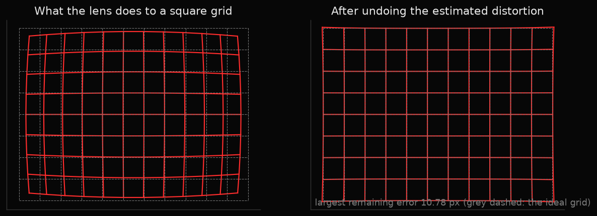
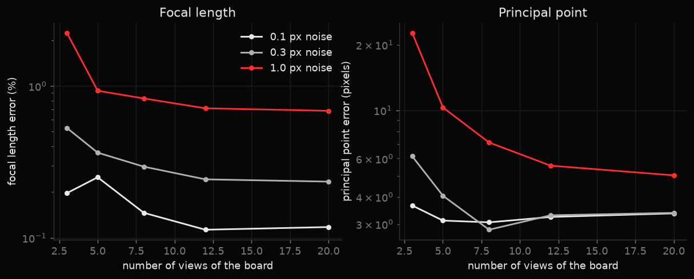
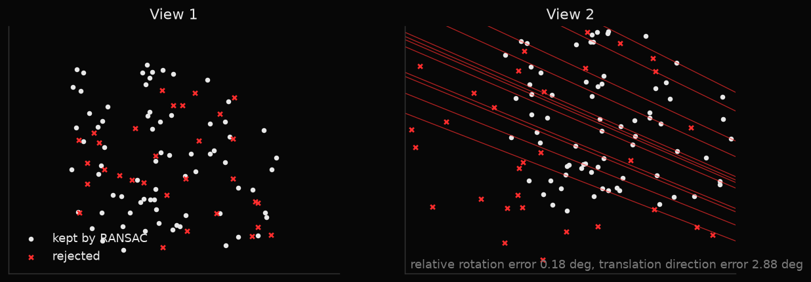
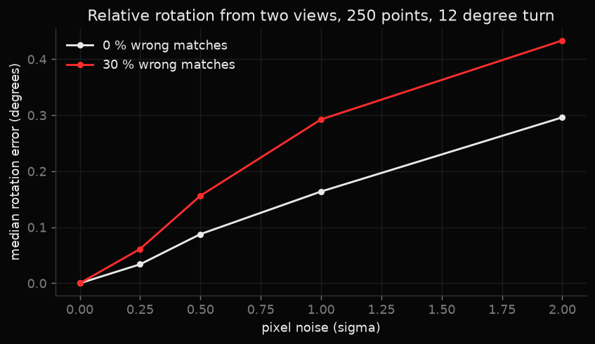

# camlab

How a camera turns the world into pixels, and how to work backwards from pixels to the camera: **calibration**, **pose estimation** and **two-view geometry**, written from scratch in NumPy (no OpenCV) and checked against synthetic scenes where the right answer is known.



## What is in it

| | |
|---|---|
| **Camera model** (`camera.py`) | Pinhole with focal lengths, principal point, skew, and Brown-Conrady lens distortion (two radial terms, two tangential). Projection, and inverting the distortion by iteration. |
| **Calibration** (`calibration.py`) | Zhang's method: a homography per view of a flat target, intrinsics in closed form from the constraints they give, extrinsics per view, then Levenberg-Marquardt over all parameters to minimise reprojection error. |
| **Pose** (`pose.py`) | Where is the camera, given an object of known shape: from a plane through the homography, from a general object through the direct linear transform, both refined through the full lens model. |
| **Two views** (`twoview.py`) | Fundamental matrix by the normalised eight-point algorithm, RANSAC against wrong matches, essential matrix, the four-way ambiguity in relative pose resolved by checking which solution puts points in front of both cameras, and linear triangulation. |
| **Optimiser** (`optimize.py`) | A small Levenberg-Marquardt with a numerical Jacobian and adaptive damping. |
| **Synthetic data** (`synth.py`) | A flat target in random poses, and random 3D scenes seen by two cameras, with noise and a chosen share of wrong matches. |

## Calibration

Fifteen random views of a 9 by 6 checkerboard, 0.3 pixel noise, for a 1280 x 960 camera with real barrel distortion:

| | Error |
|---|---:|
| Focal length | about 0.12 % (mean over six runs) |
| Radial distortion k1 (true value -0.22) | off by about 0.005 |
| Residual after refinement | 0.41 px (the noise is 0.3 px on each axis, so 0.42 px is what a perfect fit leaves) |
| Without noise | recovered to better than a ten-thousandth of a pixel |



More views and less noise help, as they should. One thing the plots show on purpose: the principal point does not improve beyond about 3 pixels however many views are used. That is **model error**, not noise: the camera has tangential distortion and the default calibration does not fit it. Turning it on (`fit_tangential=True`) brings the principal point error from 3.6 px to 0.6 px at the same noise. A model that is too simple for the lens leaves an error that no amount of data removes.

The calibration also tells you when it cannot work. It refuses fewer than three views, a target that is not flat, and views that are all alike or only slide and spin in front of the camera without tilting. Those leave the intrinsics undetermined, and the solver says so instead of returning a number.

## Pose from a known object

With the camera calibrated, 3D points with known positions and their pixels give the camera's pose. On 20 random views of the board with 0.5 px noise, the mean rotation error is 0.12 degrees and the mean translation error 0.2 mm at about half a metre. For a general 3D object, a linear solution is within 0.2 degrees and refinement brings it to 0.04.

## Two views, wrong matches, and the scale you cannot get



Given matched points in two images, RANSAC finds the fundamental matrix that most of them agree on and throws out the rest. With 40 % of the matches wrong and 0.5 px noise it keeps almost nothing wrong (over 95 % of what it accepts is right) and most of what is right (over 80 %), and the relative rotation comes out within 1 degree.



Two things are worth knowing about two-view geometry, and both are in the tests:

- **The scale is lost.** Two images cannot tell a small scene seen with a short baseline from a large scene with a long one. The translation comes out as a unit vector, and triangulated points are right up to one common factor.
- **Translation direction is the weak part.** In the example above the rotation is within 0.2 degrees and the direction of motion within 2.9. The direction depends on a small difference between nearly parallel rays.

## Run it

```
pip install -e .[dev]
pytest                              # 26 tests, about 40 seconds
python scripts/make_figures.py      # redraws everything in docs/img
```

```python
import numpy as np
from camlab.synth import checkerboard, reference_camera, render_views
from camlab.calibration import calibrate

cam, board = reference_camera(), checkerboard()
views, _, _ = render_views(cam, board, 15, np.random.default_rng(0), noise=0.3)   # pixel positions of each corner in each view
result = calibrate(board, views, fit_tangential=True)
print(result.camera.fx, result.camera.fy, result.rms)
```

With a real camera, `views` would hold the corners found in each photo of a printed checkerboard (by a corner detector, which this project does not include).

## What the tests check

- **Rotations**: round trips including angles of 0, 1e-8 and exactly pi; the nearest rotation to a noisy or reflected matrix; the `look_at` camera really points at its target.
- **Homographies**: recovered exactly without noise; refused when there are fewer than four points or all points are collinear.
- **Camera**: the distortion is inverted to a nanometre-scale tolerance, projection and back-projection agree, points behind the camera are rejected, skew enters correctly.
- **Calibration**: exact recovery without noise (all intrinsics and all four distortion terms); the closed-form solution alone is already accurate for an undistorted camera; the residual matches the noise level; refinement beats the linear solution; more views are better; skew can be estimated; it refuses the bad inputs listed above.
- **Pose**: accuracy for planar and general objects, refinement helps, the DLT refuses coplanar points, the object is always in front of the camera.
- **Two views**: the eight-point result satisfies the epipolar constraint to 1e-14 and every match lies on its epipolar line; the true pose is one of the four candidates and the right one is chosen on ten random scenes; RANSAC with 40 % outliers; triangulation exact without noise, and exactly one factor off with a unit translation.
- **Optimiser**: Rosenbrock, an exponential curve fit, and the cost never goes up.

## Limits

- There is no image processing. The corner detector, the feature matcher and the images themselves are outside this project: it starts from pixel coordinates.
- The data is synthetic and the noise is Gaussian. Real corner detections have outliers and biases that this does not model.
- The corners of the distortion figure are outside the part of the image the board covered in the calibration views, and the corrected grid is 10 pixels off there. A polynomial distortion model should not be trusted far outside the region it was fitted on.
- Only the pinhole model with polynomial distortion. No fisheye, no rolling shutter.
- The Jacobian is numerical. It is fast enough for a few dozen views and would be the first thing to replace for hundreds.

MIT licence.
